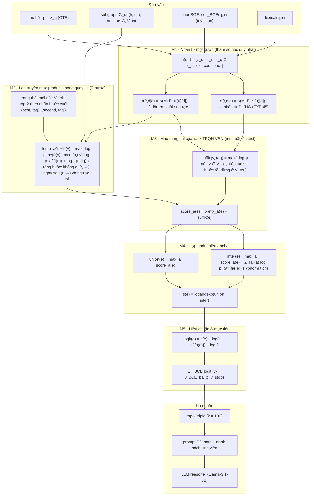

# 15. RBF-Ret: kiến trúc, hình thức hoá toán học, pseudo-code và định vị so với NBFNet / A*Net / TransferNet / REL-RAG

*Tài liệu viết cho bản thảo hội nghị. Nguồn: `retrieve/exp_qrdde/rbf.py`, `train_retriever.py`, `infer.py`, `relrag/model.py`; lập luận ở docs/11, docs/13; bằng chứng ở docs/04 (EXP-39, EXP-43, EXP-45) và BENCHMARK.md.*

> **Ghi chú tên gọi.** Trong các trao đổi trước, "RBFNet" được dùng để chỉ **NBFNet** (*Neural Bellman-Ford Network*, Zhu et al., NeurIPS 2021). Tên mô hình của chúng ta, **RBF-Ret**, viết tắt của *Relevance-gated Bellman-Ford Retriever*; chữ "R" là **relevance-gated**, không phải *radial basis function*. Tài liệu này dùng nhất quán: **NBFNet** cho baseline, **RBF-Ret** (hoặc RBF) cho phương pháp đề xuất.

---

## 1. Ký hiệu

| Ký hiệu | Nghĩa |
|---|---|
| $q$ | câu hỏi tự nhiên; $\mathbf{z}_q \in \mathbb{R}^d$ là embedding văn bản ($d = 1024$, GTE-large-en-v1.5) |
| $\mathcal{G}_q = (\mathcal{V}, \mathcal{E}, \mathcal{R})$ | subgraph của câu hỏi; $\mathcal{E} \subseteq \mathcal{V} \times \mathcal{R} \times \mathcal{V}$ |
| $e = (h_e, r_e, t_e)$ | một triple (cạnh có hướng, có nhãn) |
| $\mathcal{R}$ | tập relation xuất hiện trong $\mathcal{G}_q$; $\mathbf{z}_r \in \mathbb{R}^d$ là embedding văn bản của relation |
| $\mathcal{A} \subseteq \mathcal{V}$ | tập **anchor** (topic entity) của câu hỏi, $A = |\mathcal{A}|$ |
| $\mathcal{V}_{\text{txt}} \subseteq \mathcal{V}$ | **text entity**: entity có tên hiển thị. Phần bù $\mathcal{V} \setminus \mathcal{V}_{\text{txt}}$ là các nút trung gian CVT / mediator của Freebase (không có tên) |
| $\mathcal{D} = \{{\rightarrow}, {\leftarrow}\}$ | hướng duyệt một cạnh: xuôi $h \to t$, ngược $t \to h$ |
| $\sigma(\cdot)$, $\varsigma(\cdot) = \log \sigma(\cdot)$ | sigmoid và log-sigmoid |
| $T$ | số bước lan truyền (mặc định $T = 3$) |
| $L$ | số bước nối dài tối đa của mô-đun max-marginal ($L = 2$, hằng `COMPLETION_STEPS`) |
| $y_e \in \{0, 1\}$ | nhãn giám sát của triple $e$ |
| $\varepsilon = -10^4$ | hằng `NEG`, biểu diễn $\log 0$ ("không tới được") |

Một **walk** độ dài $k$ xuất phát từ $a$ là dãy $\omega = (a; (e_1, d_1), \ldots, (e_k, d_k))$ với $(e_i, d_i) \in \mathcal{E} \times \mathcal{D}$ nối tiếp nhau. Ký hiệu $\mathrm{end}(\omega)$ là nút cuối, $\mathrm{tag}(e, d) = (r_e, d)$ là **nhãn bước** (relation kèm hướng).

---

## 2. Tổng quan kiến trúc

RBF-Ret thay toàn bộ phần "scorer MLP trên đặc trưng triple" của SubgraphRAG / REL-RAG bằng **một quy hoạch động trên nửa vành max-plus**, trong đó tham số học duy nhất là một **nhân tử một bước** $\pi(r, d \mid q)$ và (tuỳ chọn) một **nhân tử dừng** $\varphi(r, d \mid q)$.



Hình vẽ cho bản thảo (TikZ, dạng khối ngang một cột): [`figs/rbf_architecture.tex`](figs/rbf_architecture.tex).

**Nguyên lý thiết kế, một câu:** điểm của một triple là $\log$ của **xác suất đường đi tốt nhất** đi qua triple đó, trong đó xác suất của một đường đi được **phân rã thành tích các nhân tử một bước chỉ phụ thuộc $(q, r, d)$**. Mọi thứ khác trong mô hình (không quay lui, max-marginal, hợp nhất anchor) là **ràng buộc cấu trúc không tham số**, được thêm vào để quy hoạch động tính đúng đại lượng cần tính.

---

## 3. Công thức từng mô-đun

### 3.1 M1 — Nhân tử một bước $\pi$ (relevance gate)

Đặc trưng đầu vào, chung cho cả $\pi$ và $\varphi$:

$$
\mathbf{u}(q, r) \;=\; \big[\; \mathbf{z}_q \;;\; \mathbf{z}_r \;;\; \mathbf{z}_q \odot \mathbf{z}_r \;;\; \mathrm{lex}(q, r) \;;\; \cos(\mathbf{z}_q, \mathbf{z}_r) \;;\; \boldsymbol{\rho}(q, r) \;\big] \in \mathbb{R}^{3d + 2 + c}
$$

trong đó $\mathrm{lex}(q,r)$ là điểm trùng từ (word-overlap) giữa câu hỏi và chuỗi văn bản của relation, và $\boldsymbol{\rho}(q,r) = \big[\cos_{\text{BGE}}(q, r),\; \cos_{\text{BGE}}(q, r) - \max_{r'} \cos_{\text{BGE}}(q, r')\big]$ là prior từ bộ mã hoá relation BGE-M3 + LoRA ($c = 2$; $c = 0$ nếu tắt).

$$
\boxed{\;\pi(r, d \mid q) \;=\; \sigma\big( \mathrm{MLP}_\pi(\mathbf{u}(q,r))_d \big), \qquad d \in \{{\rightarrow}, {\leftarrow}\}\;}
$$

$\mathrm{MLP}_\pi: \mathbb{R}^{3d+2+c} \to \mathbb{R}^{256} \to \mathbb{R}^{256} \to \mathbb{R}^{2}$ (ReLU). **Đây là toàn bộ tham số học của lõi mô hình** (~0.8M tham số), và quan trọng hơn: nó **không nhận bất kỳ đặc trưng nào của entity, của vị trí trong đường đi, hay của bước trước đó**. Tính chất này là điều kiện cần cho Mệnh đề 1 (§5).

*Ablation đầu vào* (EXP-45, cờ `--pi_input`): bỏ $\mathrm{lex}$ cho kết quả tốt hơn khi transfer (WebQSP→CWQ ansR@50 90.3 → 92.0), vì trùng từ là tín hiệu đặc thù theo cách diễn đạt của tập huấn luyện.

### 3.2 M2 — Lan truyền max-product trên nửa vành $(\max, +)$

Ký hiệu $\lambda(r, d) = \log \pi(r, d \mid q)$. Với một anchor $a$, điểm (log) của một walk là

$$
S(\omega) \;=\; \sum_{i=1}^{k} \lambda(r_{e_i}, d_i),
$$

tức là **tích** các nhân tử một bước trong không gian xác suất. Đại lượng cần tính là max-marginal theo nút:

$$
\log p_a^{(T)}(v) \;=\; \max_{\omega \,\in\, \Omega_{a \to v}^{\le T}} S(\omega), \qquad \log p_a^{(0)}(v) = \begin{cases} 0 & v = a \\ \varepsilon & v \ne a \end{cases}
$$

Quy hoạch động Bellman–Ford tổng quát trên nửa vành $(\max, +)$:

$$
\boxed{\;\log p_a^{(t+1)}(v) \;=\; \max\Big( \log p_a^{(t)}(v), \;\; \max_{(u, r, v) \in \mathcal{E}^{\pm}} \big[ \log p_a^{(t)}(u) + \lambda(r, d) \big] \Big)\;}
$$

với $\mathcal{E}^{\pm}$ là tập cạnh hai chiều: mỗi triple $(h, r, t)$ sinh một bước xuôi $h \to t$ trọng số $\lambda(r, \rightarrow)$ và một bước ngược $t \to h$ trọng số $\lambda(r, \leftarrow)$.

So với NBFNet, phép hợp $\oplus$ là $\max$ chứ không phải $\sum$, và "biểu diễn" của mỗi nút là **một số thực** chứ không phải vector $\mathbb{R}^{d'}$. Hệ quả: mỗi đường đi được giữ **nguyên vẹn như một tích riêng**, không bị trộn với đường khác (xem §6.2).

### 3.3 M3 — Ràng buộc không quay lui (non-backtracking) và trạng thái Viterbi top-2

**Vấn đề.** Khi anchor là hub (ví dụ `Asia`, một nút `time_zone`, một `type`), walk dạng "nảy" $u \xrightarrow{r^{-1}} w \xrightarrow{r} u'$ có điểm bằng tích hai nhân tử cao, và tràn ngập top-$k$ (ví dụ đo được: `Asia time_zones X` đạt $-0.51$ trong khi đáp án đúng $-2.22$).

**Định nghĩa.** Một walk là *không quay lui* nếu không tồn tại $i$ sao cho $\mathrm{tag}(e_{i+1}, d_{i+1}) = (r_{e_i}, \bar{d_i})$ với $\bar{\cdot}$ là hướng đảo. Tức là **cấm đi relation $r$ theo chiều ngược ngay sau khi đã đi $r$ theo chiều xuôi, và ngược lại**.

**Trạng thái đủ.** Đặt, với mỗi nút $v$ và mỗi nhãn bước $\tau$,

$$
M_v(\tau) \;=\; \max\{\, S(\omega) \;:\; \omega \in \Omega_{a \to v},\; \mathrm{tag}(\text{bước cuối của } \omega) = \tau \,\}.
$$

Phép chuyển trạng thái chỉ cần đại lượng $\max_{\tau \ne \bar\tau_0} M_v(\tau)$ cho **đúng một** $\bar\tau_0$ bị cấm. Do đó chỉ cần lưu cặp **top-2 theo nhãn khác nhau**:

$$
\begin{aligned}
b_v &= \max_\tau M_v(\tau), \quad & \beta_v &= \arg\max_\tau M_v(\tau), \\
s_v &= \max_{\tau \ne \beta_v} M_v(\tau), \quad & \varsigma_v &= \arg\max_{\tau \ne \beta_v} M_v(\tau),
\end{aligned}
\qquad
\boxed{\;
\mathrm{excl}(v, \tau) = \begin{cases} s_v & \beta_v = \tau \\ b_v & \beta_v \ne \tau\end{cases}
\;}
$$

Bước lan truyền trở thành

$$
\text{(xuôi)}\quad c^{\rightarrow}_e = \mathrm{excl}\big(h_e,\; (r_e, {\leftarrow})\big) + \lambda(r_e, {\rightarrow}), \qquad
\text{(ngược)}\quad c^{\leftarrow}_e = \mathrm{excl}\big(t_e,\; (r_e, {\rightarrow})\big) + \lambda(r_e, {\leftarrow}),
$$

rồi hợp nhất bằng `scatter_max` hai lần (lần hai loại nhãn đã thắng lần một) để cập nhật $(b, \beta, s, \varsigma)$.

**Điểm tiền tố của một triple** (prefix score: walk từ $a$ kết thúc bằng việc đi qua $e$):

$$
\mathrm{pre}^{\rightarrow}_a(e) = c^{\rightarrow}_e, \qquad \mathrm{pre}^{\leftarrow}_a(e) = c^{\leftarrow}_e \quad \text{(tính sau vòng lặp thứ } T\text{)}.
$$

> **Ý nghĩa với G2.** Line graph của REL-RAG tránh được quay lui *vì trạng thái của nó là cạnh*, với cái giá $\sum_v \deg(v)^2$ cạnh. Ở đây ta thu được đúng tính chất đó trên entity graph với **2 trạng thái / nút**. Cài đặt đã được kiểm chứng khớp brute-force trên 300 đồ thị ngẫu nhiên.

### 3.4 M4 — Max-marginal của walk trọn vẹn (mm) và nhân tử dừng $\varphi$

**Vấn đề cấu trúc.** Vì $\lambda \le 0$, điểm tiền tố **đơn điệu không tăng** dọc theo đường đi:

$$
\mathrm{pre}_a(e_{1:i+1}) \;\le\; \mathrm{pre}_a(e_{1:i}) \qquad \forall i.
$$

Do đó hop đầu `anchor → CVT` **luôn** xếp trên hop hữu ích `CVT → đáp án`. Trên Freebase, một CVT có thể có 80 cạnh `member`, nên top-$k$ bị các hop đầu chiếm hết. Đây là lỗi *cấu trúc* của max-product, không phải lỗi học.

**Giải pháp.** Chấm mỗi triple bằng **walk trọn vẹn tốt nhất đi qua nó**, với "trọn vẹn" nghĩa là *kết thúc ở một text entity* (một walk không được dừng ở nút CVT, vì CVT không phải đáp án hợp lệ). Định nghĩa hàm hậu tố $\Psi$, tính bằng quy hoạch động lùi $\le L$ bước, độc lập với anchor:

$$
\boxed{\;
\Psi(v, \tau) \;=\; \max\Big(
\underbrace{\mathrm{stop}(v, \tau)}_{\text{dừng tại } v},\;\;
\underbrace{\max_{\substack{(v, r, w) \in \mathcal{E}^{\pm} \\ (r, d) \ne \bar\tau}} \big[\lambda(r, d) + \Psi(w, (r,d))\big]}_{\text{đi tiếp}}
\Big)\;}
$$

với điều kiện dừng

$$
\mathrm{stop}(v, \tau) \;=\;
\begin{cases}
0 & v \in \mathcal{V}_{\text{txt}},\; \text{không dùng } \varphi \quad\text{(dừng miễn phí)}\\[2pt]
\log \varphi(r_\tau, d_\tau \mid q) & v \in \mathcal{V}_{\text{txt}},\; \text{dùng } \varphi \\[2pt]
\varepsilon & v \notin \mathcal{V}_{\text{txt}}
\end{cases}
$$

Điểm triple cuối cùng theo từng anchor:

$$
\mathrm{score}_a(e) \;=\; \max\Big(
\mathrm{pre}^{\rightarrow}_a(e) + \Psi\big(t_e, (r_e, {\rightarrow})\big),\;\;
\mathrm{pre}^{\leftarrow}_a(e) + \Psi\big(h_e, (r_e, {\leftarrow})\big)
\Big)
$$

tức là $\mathrm{score}_a(e) = \max\{S(\omega) : \omega$ là walk không quay lui từ $a$, độ dài $\le T + L$, **đi qua $e$**, **kết thúc ở text entity**$\}$ — đúng định nghĩa max-marginal theo cạnh của một mô hình Viterbi.

**Nhân tử dừng** $\varphi$ (xem §7 để bàn kỹ):

$$
\boxed{\;\varphi(r, d \mid q) \;=\; \sigma\big(\mathrm{MLP}_\varphi(\mathbf{u}(q, r))_d\big)\;}
$$

— *cùng đầu vào với $\pi$*, nên vẫn chỉ phụ thuộc $(q, r, d)$ và không phá vỡ tính phân rã theo bước. Diễn giải xác suất: $\pi$ là xác suất **chuyển tiếp**, $\varphi$ là xác suất **hấp thụ**, và mô hình trở thành một xích Markov có hấp thụ, có điều kiện theo câu hỏi, trên $\mathcal{G}_q$.

### 3.5 M5 — Hợp nhất nhiều anchor: hợp (max) và giao (t-norm tích)

Với $\mathcal{A} = \{a_1, \ldots, a_A\}$, đặt $P(v) = \sum_{a} \log p_a^{(T)}(v)$ (log của t-norm tích, tức giao mờ). Với $\mathrm{far}^{\rightarrow}(e) = t_e$, $\mathrm{far}^{\leftarrow}(e) = h_e$:

$$
\begin{aligned}
\mathrm{union}(e) &= \max_{a \in \mathcal{A}} \mathrm{score}_a(e) & &\text{(bằng chứng từ \emph{một} anchor bất kỳ)}\\[4pt]
\mathrm{inter}(e) &= \max_{a \in \mathcal{A}} \; \max_{d \in \mathcal{D}} \Big[ \mathrm{score}^{d}_a(e) + \underbrace{\textstyle P(\mathrm{far}^d(e)) - \log p_a^{(T)}(\mathrm{far}^d(e))}_{\text{các anchor còn lại cũng tới được đầu xa của } e} \Big] & &\text{(giao)}\\[4pt]
s(e) &= \operatorname{logaddexp}\big(\mathrm{union}(e), \mathrm{inter}(e)\big) & &\text{(hợp mềm hai nguồn bằng chứng)}
\end{aligned}
$$

**Tính nhất quán một anchor.** Khi $A = 1$ thì $P(v) - \log p_{a_1}(v) = 0$, nên $\mathrm{inter} = \mathrm{union}$ và $s(e) = \mathrm{union}(e) + \log 2$. Hằng $\log 2$ được trừ lại ở tầng hiệu chuẩn, nên **mô hình nhiều anchor trùng khít mô hình một anchor** trên câu một topic — nhờ đó thành phần này không thể làm giảm kết quả in-distribution (đã kiểm bằng `assert`).

*Kết quả âm đã ghi nhận (docs/11 §7):* biến thể soft-AND (coi anchor khác là ràng buộc mềm $\epsilon$) làm nhóm $\ge 2$ topic giảm từ 75.3 xuống 70.8–73.5. Giả thuyết H3 bị bác ở dạng đó; dạng logaddexp ở trên là dạng duy nhất trung tính–hoặc–có lợi.

### 3.6 M6 — Hiệu chuẩn logit và hàm mục tiêu

$s(e) \le 0$ là log của một xác suất. Để dùng BCE chuẩn, chuyển sang logit:

$$
\boxed{\;\ell(e) \;=\; \operatorname{logit}\big(e^{\,s(e) - \log 2}\big) \;=\; \big(s(e) - \log 2\big) \;-\; \log\!\big(-\operatorname{expm1}(s(e) - \log 2)\big)\;}
$$

(cài đặt `log_to_logit`, có clamp $s \le -10^{-6}$ để ổn định số học).

**Hàm mất mát chính** — BCE trên toàn bộ triple của một câu hỏi (giao thức SubgraphRAG: một câu = một batch):

$$
\mathcal{L}_{\text{ret}} \;=\; \frac{1}{|\mathcal{E}|}\sum_{e \in \mathcal{E}} w^{+}\, y_e \,\varsigma(\ell(e)) \;+\; (1 - y_e)\, \varsigma(-\ell(e)),
\qquad
w^{+} = \frac{N(n^-)}{N(n^+)},\; N(n) = \frac{1 - \gamma^n}{1 - \gamma},\; \gamma = 0.999
$$

($w^+$ là trọng số *effective number* của WL; tuỳ chọn `--pos_weight effective_num`).

**Hàm mất mát của nhân tử dừng** — chỉ trên các bước cuối *khả dĩ*. Đặt mặt nạ $m_{r,d} = 1$ nếu tồn tại một bước $(r, d)$ đi **vào một text entity**, và nhãn $y^{\text{stop}}_{r,d} = 1$ nếu tồn tại một triple **trên chain gold** mà bước $(r, d)$ của nó đi vào một **entity đáp án**:

$$
\mathcal{L}_{\text{stop}} \;=\; \tfrac{1}{2}\; \underset{m_{r,d}=1,\; y^{\text{stop}}=1}{\mathbb{E}} \big[\mathrm{BCE}\big] \;+\; \tfrac{1}{2}\; \underset{m_{r,d}=1,\; y^{\text{stop}}=0}{\mathbb{E}} \big[\mathrm{BCE}\big]
$$

(cân bằng 50/50 vì một câu chỉ có vài bước cuối đúng trong hàng chục relation).

**Hai chế độ huấn luyện:**
- *đồng thời*: $\mathcal{L} = \mathcal{L}_{\text{ret}} + \mathcal{L}_{\text{stop}}$;
- *hai pha* (cấu hình dùng trong EXP-45, cờ `--stop --init_from`): nạp $\pi$ từ một run đã train, **đóng băng $\pi$**, chỉ học $\varphi$; chọn checkpoint theo `val stop_top1` thay vì `val triple_recall@100`. Cách này giữ nguyên mọi kết quả retrieval đã công bố và cô lập được đóng góp của $\varphi$.

**Nhãn $y_e$.** Ba nguồn, dùng chung một khuôn: `sp` = shortest path (SubgraphRAG); `v1/v2/v3` = nhãn suy ra từ gold SPARQL (`labels.py`), gồm triple của *chain* và của *constraint*; câu không có nhãn gold giữ nhãn `sp`. Nhãn áp cho **cả train và val**, để model selection cùng mục tiêu.

### 3.7 M7 — Giao diện hạ nguồn

Mô-đun chấm điểm trả về $\ell(e)$ cho mọi triple; pipeline lấy top-$k$ ($k = 100$) và chuyển cho LLM. **Giao diện với reasoner giống hệt SubgraphRAG**, nên mọi so sánh QA là so sánh công bằng ở cùng budget. Prompt P2 (docs/12) trình bày bằng chứng dưới dạng *path* kèm danh sách ứng viên, thay vì danh sách triple rời.

---

## 4. Pseudo-code

### Algorithm 1 — Lõi chấm điểm `RBF-Score` (một câu hỏi, một lượt forward)

```text
Input : q, G_q = (V, E, R), anchors A, text entities V_txt, horizon T, completion L,
        flags mm ∈ {false, true}, use_phi ∈ {false, true}
Output: s(e) ∈ R for every triple e ∈ E

# ---------- M1: nhân tử một bước (chỉ phụ thuộc (q, r, d)) ----------
 1  for each distinct relation r ∈ R:
 2      u[r]  ← [ z_q ; z_r ; z_q ⊙ z_r ; lex(q,r) ; cos(z_q,z_r) ; prior(q,r) ]
 3      (λ→[r], λ←[r]) ← log σ( MLP_π(u[r]) )                 # ∈ (−∞, 0]
 4      if use_phi: (ν→[r], ν←[r]) ← log σ( MLP_φ(u[r]) )     # nhân tử dừng

# ---------- M2+M3: lan truyền max-product không quay lui, T bước ----------
 5  b[a, v] ← 0 if v = a else NEG ;  s2[a, v] ← NEG           # top-2 theo nhãn bước cuối
 6  β[a, v] ← ⊥ ;  ς[a, v] ← ⊥
 7  repeat T times:
 8      for each e = (h, r, t) ∈ E:                            # vector hoá trên toàn bộ E
 9          c→[·, e] ← EXCL(b, β, s2, h, tag(r,←)) + λ→[r]
10          c←[·, e] ← EXCL(b, β, s2, t, tag(r,→)) + λ←[r]
11      (b, β, s2, ς) ← TOP2-MERGE( b, β, s2, ς,
                                    candidates = [c→ , c←],
                                    tags       = [tag(r,→), tag(r,←)],
                                    dest       = [t, h] )
12  pre→[a, e] ← EXCL(b, β, s2, h_e, tag(r_e,←)) + λ→[r_e]     # điểm tiền tố qua e
13  pre←[a, e] ← EXCL(b, β, s2, t_e, tag(r_e,→)) + λ←[r_e]
14  logp[a, v] ← b[a, v]

# ---------- M4: max-marginal của walk trọn vẹn (chỉ bật lúc test) ----------
15  if mm:
16      Ψ[v] ← 0 if (v ∈ V_txt and not use_phi) else NEG       # giá trị hậu tố, DP lùi
17      stop→[e] ← ν→[r_e] if (use_phi and t_e ∈ V_txt) else NEG
18      stop←[e] ← ν←[r_e] if (use_phi and h_e ∈ V_txt) else NEG
19      repeat L times:                                        # cùng TOP2-MERGE, chiều ngược
20          d→[e] ← max( EXCL(Ψ, …, t_e, tag(r_e,←)), stop→[e] ) + λ→[r_e]   # hậu tố tại h_e
21          d←[e] ← max( EXCL(Ψ, …, h_e, tag(r_e,→)), stop←[e] ) + λ←[r_e]   # hậu tố tại t_e
22          Ψ ← TOP2-MERGE(Ψ, …, candidates = [d→, d←], dest = [h, t])
23      pre→[a, e] ← pre→[a, e] + max( EXCL(Ψ, …, t_e, tag(r_e,←)), stop→[e] )
24      pre←[a, e] ← pre←[a, e] + max( EXCL(Ψ, …, h_e, tag(r_e,→)), stop←[e] )

# ---------- M5: hợp nhất nhiều anchor ----------
25  score[a, e] ← max( pre→[a, e], pre←[a, e] )
26  union[e]    ← max_a score[a, e]
27  P[v]        ← Σ_a logp[a, v]
28  inter[e]    ← max_a max( pre→[a,e] + P[t_e] − logp[a, t_e],
                             pre←[a,e] + P[h_e] − logp[a, h_e] )
29  s[e]        ← logaddexp( union[e], inter[e] )
30  return s
```

Hàm phụ:

```text
EXCL(b, β, s2, v, τ)  :  return s2[·, v] if β[·, v] = τ else b[·, v]
        # giá trị tốt nhất tại v trong các walk KHÔNG kết thúc bằng nhãn bước τ

TOP2-MERGE(b, β, s2, ς, candidates, tags, dest):
        (m1, i1) ← scatter_max(candidates, dest)               # tốt nhất tới mỗi đích
        τ1       ← tags[i1]
        (b', β') ← (m1, τ1) nếu m1 > b, ngược lại (b, β)
        others   ← candidates với mọi phần tử có tag = β' bị đặt về NEG
        (m2, i2) ← scatter_max(others, dest) ;  τ2 ← tags[i2]
        (s2', ς')← max theo giá trị của { (m2, τ2),
                                          (b, β) nếu β ≠ β',
                                          (s2, ς) nếu ς ≠ β' }
        return (b', β', s2', ς')
```

### Algorithm 2 — Huấn luyện

```text
Input : tập train D, tập val D_val, nhãn (sp | v1 | v2 | v3), prior BGE (tuỳ chọn),
        chế độ ∈ {joint, phi-only}, lr = 1e-3 (Adam), patience = 10, seed = 42
 1  if nhãn ≠ sp:  thay nhãn shortest-path bằng nhãn gold-query cho MỌI record có nhãn
                   (áp cho cả train và val)
 2  if chế độ = phi-only:  nạp π từ run nguồn ; đóng băng mọi tham số trừ MLP_φ
 3  metric chọn checkpoint ← (chế độ = phi-only) ? val stop_top1 : val triple_recall@100
 4  for epoch = 0, 1, 2, …:
 5      for each câu hỏi (q, G_q, y) ∈ shuffle(D):
 6          s ← RBF-Score(q, G_q, mm = FALSE, use_phi theo cấu hình)   # mm TẮT khi train
 7          ℓ ← log_to_logit( s − log 2 )
 8          L ← 0
 9          if có nhãn stop:  L ← L + BCE_balanced( MLP_φ(u), y_stop, mask_stop )
10          if chế độ ≠ phi-only:
11              w⁺ ← effective_number_weight(y)        # tuỳ chọn
12              L  ← L + BCE_with_logits(ℓ, y, pos_weight = w⁺)
13          Adam step trên L
14      v ← Validate(D_val)          # ans_recall@{20,50,100,200}, triple_recall@…, stop_top1
15      lưu best.pt nếu v[metric] cải thiện ; dừng sau `patience` epoch không cải thiện
```

### Algorithm 3 — Suy luận đầy đủ (retrieve-then-reason)

```text
Input : câu hỏi test, run đã train, budget k = 100
 1  nạp model ; ĐẶT mm ← TRUE                    # max-marginal chỉ bật lúc test
 2  for each câu hỏi:
 3      anchors ← topic entity của câu hỏi
 4      s ← RBF-Score(q, G_q, anchors, mm = TRUE)
 5      # (tuỳ chọn, chỉ dùng cho các ô ablation: nhiều anchor-set rồi hợp bằng max của điểm z-chuẩn hoá)
 6      #   base    : [anchors]
 7      #   adr     : [anchors] + [{a} : a ∈ anchors]
 8      #   aer     : [anchors] + [anchors ∪ bridges(top-3 triple)]
 9      #   fuse    : s ← max_pass z-normalise(s_pass)
10      top ← argsort(s, desc)[: 500]            # lưu 500, dùng k đầu
11      ghi {question, q_entity, a_entity_in_graph, scored_triples}
12  # ----- reasoning -----
13  context ← top-k triple, trình bày theo prompt P2 (path + danh sách ứng viên)
14  answer  ← LLM(context, q)
15  đánh giá: ansR@k, PathHit@k, Cons-R@k (retrieval) ; Hit, Macro-F1 (QA)
```

---

## 5. Mệnh đề hình thức và độ phức tạp

> Các mệnh đề dưới đây là **phát biểu đề xuất cho bản thảo**. (P1) và (P4) là hệ quả trực tiếp của định nghĩa; (P2) và (P3) đã được kiểm chứng bằng brute force (300 đồ thị ngẫu nhiên) nhưng **chứng minh hình thức còn phải viết** — đây là mục 4 trong danh sách việc còn thiếu của docs/13 §5.

**Mệnh đề 1 (bất biến tổ hợp / systematicity).**
Gọi $\mathcal{H}_{\text{RBF}}$ là lớp giả thuyết của hàm chấm điểm với $\pi$ cố định. Với hai dãy relation $\mathbf{r} = (r_1, \ldots, r_k)$ và $\mathbf{r}' = (r'_1, \ldots, r'_k)$ là hoán vị/tổ hợp bất kỳ của cùng một tập relation, điểm $S$ của một walk chỉ phụ thuộc **đa tập** $\{(r_i, d_i)\}$:
$$
S(\omega) = \sum_i \lambda(r_i, d_i) \;\;\Longrightarrow\;\; S \text{ bất biến với thứ tự các bước.}
$$
Hệ quả: **không tồn tại tham số nào trong $\mathcal{H}_{\text{RBF}}$ được đánh chỉ số bởi một cặp (hoặc một dãy) relation**, nên mô hình không thể học thuộc một tổ hợp cụ thể; nếu mọi relation của một tổ hợp mới đã xuất hiện trong huấn luyện, điểm của tổ hợp đó được xác định hoàn toàn bởi các nhân tử đã học.
*Bằng chứng thực nghiệm (ablation cơ chế, docs/11):* thêm lại một MLP nhìn thấy đặc trưng-sau-bước cùng relation (`rbfmlp_nb`, **không có DDE**) làm nhóm "tổ hợp mới" tụt **84 → 51.2**, ngang WL (53.1). Mọi bộ chấm có khả năng kết hợp đặc trưng nhiều bước đều học thuộc tổ hợp.

**Mệnh đề 2 (tính đúng của lan truyền không quay lui với 2 trạng thái).**
Quy hoạch động ở §3.3, với trạng thái $(b_v, \beta_v, s_v, \varsigma_v)$, tính **đúng** $\max\{S(\omega) : \omega$ là walk không quay lui độ dài $\le T$ từ $a$ tới $v\}$.
*Ý tưởng chứng minh:* trạng thái đầy đủ của bài toán là $(v, \tau)$ với $\tau$ là nhãn bước cuối; phép chuyển tại mỗi bước loại **đúng một** nhãn $\bar\tau_0$, nên $\max_{\tau \ne \bar\tau_0} M_v(\tau)$ chỉ cần top-2 theo nhãn khác nhau. Tính tối ưu con đúng vì nửa vành $(\max, +)$ có tính đơn điệu và $\lambda \le 0$.

**Mệnh đề 3 (mm là max-marginal đúng).**
$\mathrm{score}_a(e)$ ở §3.4 bằng $\max\{S(\omega)\}$ trên tập các walk không quay lui từ $a$, độ dài $\le T + L$, đi qua $e$ và kết thúc tại $\mathcal{V}_{\text{txt}}$. Khi có $\varphi$, đại lượng là $\max\{S(\omega) + \log\varphi(\text{bước cuối của }\omega)\}$ — tức log-xác suất Viterbi của một walk **hoàn chỉnh** theo xích Markov có hấp thụ $(\pi, \varphi)$.

**Mệnh đề 4 (độ phức tạp).**

| | thời gian | bộ nhớ trạng thái | tiền xử lý / đĩa |
|---|---|---|---|
| SubgraphRAG (MLP + DDE) | $O(|\mathcal{E}|)$ | $O(|\mathcal{V}| d)$ | không |
| REL-RAG (line graph + bi-GCN) | $O\big(\sum_v \deg(v)^2 \cdot d\big)$ | $O(|\mathcal{E}| d)$ | **83× (WebQSP) / 107× (CWQ)** số cạnh; 77 MB/câu; ~3.5 h dựng + ~1 h hậu xử lý cho CWQ test |
| **RBF-Ret** | $O\big(A\,(T + L)\,|\mathcal{E}|\big)$ | $O(A\,|\mathcal{V}|)$, **4 số/nút** | **không** |

Điểm then chốt: RBF **không nhân với $d$** ở vòng lan truyền (trạng thái là số thực, không phải vector), và $d$ chỉ xuất hiện một lần ở $\mathrm{MLP}_\pi$ chạy trên $|\mathcal{R}|$ relation **duy nhất** (thường $|\mathcal{R}| \ll |\mathcal{E}|$).

---

## 6. So sánh ý tưởng: kế thừa gì, đổi mới gì

### 6.1 Bảng đối chiếu

| Chiều so sánh | NBFNet (NeurIPS'21) | A*Net (NeurIPS'23) | TransferNet (EMNLP'21) | REL-RAG / RAPL (ICML'26) | **RBF-Ret (đề xuất)** |
|---|---|---|---|---|---|
| Khung tính toán | Bellman–Ford tổng quát trên nửa vành học được | NBFNet + ưu tiên nút, chỉ mở rộng top-$K$ | chuyển điểm entity theo ma trận kề có trọng số | 2-layer bi-GCN trên **line graph** + decode path tự hồi quy | Bellman–Ford trên nửa vành $(\max, +)$ **cố định** |
| Phép hợp $\oplus$ | $\mathrm{sum}$ / PNA (**cộng dồn**) | như NBFNet | $\mathrm{sum}$ (cộng dồn qua các path) | $\mathrm{sum}$ (GCN chuẩn hoá bậc) | $\boxed{\max}$ (**Viterbi**) |
| Biểu diễn trạng thái nút | vector $\mathbb{R}^{d'}$ | vector $\mathbb{R}^{d'}$ | vô hướng (điểm) | vector trên **cạnh** | **vô hướng + nhãn bước cuối** (4 số) |
| Nhân tử một bước | $w_r(q)$ học riêng theo **id relation** (transductive) | như NBFNet | $\alpha^{(t)}_r$, **riêng cho từng bước $t$** | ngầm, qua trọng số GCN và dot-product cuối | $\pi(r,d\mid q)$ từ **embedding văn bản**, **dùng chung cho mọi bước** |
| Điều kiện theo câu hỏi | theo quan hệ truy vấn (link prediction) | như trên | theo **biểu diễn câu hỏi riêng của từng bước** | chỉ ở dot-product cuối và ở ngữ cảnh decode | ngay trong nhân tử, ở **mọi** bước |
| Quay lui | không xử lý | không xử lý | không xử lý | tránh được *gián tiếp* vì trạng thái là cạnh (giá $\sum\deg^2$) | **xử lý tường minh, chính xác, 2 trạng thái/nút** |
| Dừng / độ dài đường | không có; $T$ cố định | không có | halting mềm, trộn điểm qua các bước | **token STOP** trong softmax của decoder tự hồi quy | **nhân tử dừng $\varphi(r,d\mid q)$** trong DP, dạng đóng |
| Đầu ra | điểm link prediction $(u, q, v)$ | như trên | phân phối đáp án (reader) | tập triple do decode tự do (số lượng thay đổi 42–193/câu) | **top-$k$ triple làm context cho LLM** (budget kiểm soát được) |
| Kiểm tra tổng quát hoá tổ hợp | không | không | không | có (OOD), nhưng cơ chế là line graph | **là mục tiêu thiết kế chính**, có chẩn đoán + ablation cơ chế |

### 6.2 Bản chất kế thừa

1. **Từ NBFNet — khung Bellman–Ford tổng quát.** Ý tưởng cốt lõi được giữ nguyên: biểu diễn của một cặp $(a, v)$ được tính bằng quy hoạch động trên các đường đi, với message *nhân* theo relation, nên mỗi đường đi là một tích riêng. Đây chính là cơ chế trả lời cho luận điểm "relation mixing" của REL-RAG — nhưng luận điểm đó **chỉ đúng cho message cộng dồn**.
2. **Từ A*Net — tinh thần "không cần duyệt toàn bộ".** RBF không mượn hàng đợi ưu tiên của A*Net, nhưng chia sẻ kết luận: chi phí của suy luận đa bước trên KG có thể giữ **tuyến tính theo số cạnh**, không cần biến đổi đồ thị. Ở RBF, phần tiết kiệm đến từ việc *trạng thái là vô hướng* chứ không phải từ việc tỉa nhánh — nên không có xấp xỉ, DP vẫn chính xác.
3. **Từ TransferNet — chuyển điểm entity qua điểm relation theo từng bước.** TransferNet là tiền lệ gần nhất về mặt *hình thức tính toán*: điểm entity ở bước $t$ được chuyển qua một ma trận kề mà trọng số là độ liên quan relation–câu hỏi.
4. **Từ REL-RAG — tín hiệu "đâu là bước cuối".** Nhân tử dừng $\varphi$ là ý tưởng mượn thẳng từ token STOP trong decoder của REL-RAG (xem §7).

### 6.3 Bản chất đổi mới (những điểm cần claim)

| # | Đổi mới | Khác gì với tiền lệ | Vì sao quan trọng |
|---|---|---|---|
| **N1** | **$\oplus = \max$ thay cho $\mathrm{sum}$** | NBFNet / A*Net / TransferNet đều cộng dồn | Cộng dồn trộn bằng chứng của nhiều đường; max giữ **một đường giải thích được**, và cho phép định nghĩa max-marginal theo cạnh — đại lượng khớp đúng với bài toán "triple này có nằm trên đường trả lời không" |
| **N2** | **Nhân tử dùng chung giữa các bước, chỉ phụ thuộc $(q, r, d)$, lấy từ embedding văn bản** | TransferNet dùng attention **riêng cho từng bước**; NBFNet dùng embedding **theo id relation** (không chuyển được sang KG khác) | Đây là điều kiện của Mệnh đề 1. Attention theo bước *vẫn có thể* học thuộc tổ hợp (vị trí $t$ mã hoá được thứ tự); nhân tử dùng chung thì không. Embedding văn bản cho phép transfer sang KG/domain mới mà không cần relation đã thấy |
| **N3** | **Ràng buộc không quay lui chính xác với 2 trạng thái/nút** | Không có trong NBFNet, A*Net, TransferNet. Line graph của REL-RAG có tính chất này nhưng phải trả $\sum_v\deg(v)^2$ cạnh | **Phản biện có điều kiện cho luận điểm "relation mixing"**: tính chất mà REL-RAG gán cho line graph đạt được trên entity graph với 2 số/nút |
| **N4** | **Max-marginal của walk trọn vẹn (mm) với ràng buộc kết thúc ở text entity** | Không tiền lệ. NBFNet chấm nút đích; REL-RAG chấm cạnh trong line graph | Sửa lỗi *cấu trúc* của max-product (tiền tố luôn thắng đường đầy đủ) mà **không thêm tham số nào**. Tác dụng đo được: WebQSP 89.6→91.4, WebQSP→CWQ 81.8→87.1 |
| **N5** | **Hợp nhất nhiều anchor bằng max ∪ t-norm tích, không tham số, nhất quán với trường hợp một anchor** | NBFNet/A*Net là bài toán một nguồn; REL-RAG decode từ từng topic rồi gộp | Xử lý câu hội (conjunction) mà **không cần dữ liệu huấn luyện nhiều anchor**; đảm bảo không làm hại ô in-distribution |
| **N6** | **Bài toán và giao diện: retriever theo budget cho LLM, không phải link prediction hay reader** | NBFNet/A*Net: link prediction. TransferNet: reader sinh đáp án trực tiếp. REL-RAG: decode tự do, số triple không kiểm soát | Giao diện top-$k$ giống hệt SubgraphRAG → mọi so sánh QA là ở cùng budget; và cho phép tách bạch đóng góp retrieval với đóng góp prompt bằng thiết kế 2×2 |
| **N7** | **Chẩn đoán làm trục chính** (D1): lỗi transfer của retriever KGQA là lỗi **tổng quát hoá tổ hợp**, không phải ngoại suy độ dài | Không paper nào ở trên đặt câu hỏi này cho retriever KGQA | Đây là đóng góp **độc lập với phương pháp**: 2-hop, tổ hợp đã thấy 66.0 vs tổ hợp mới 49.2 vs mốc train-trong-miền 88.5 |

### 6.4 Câu trả lời ngắn cho reviewer: *"Đây chỉ là NBFNet áp vào retrieval?"*

> Ba lựa chọn thiết kế khác nhau về bản chất, và **mỗi lựa chọn đều có ablation**: (i) nửa vành là $(\max, +)$ chứ không phải $(\mathrm{sum}, \times)$, nên điểm là max-marginal Viterbi chứ không phải tổng bằng chứng; (ii) nhân tử là *xác suất dùng chung giữa các bước, lấy từ văn bản của relation*, nên lớp giả thuyết không chứa tham số nào đánh chỉ số theo cặp relation — đây là điều NBFNet (embedding theo id, inductive bias cộng dồn) và TransferNet (attention riêng theo bước) đều không có; (iii) hai thành phần không có tiền lệ — ràng buộc không quay lui chính xác và max-marginal của walk trọn vẹn. Thêm nữa, bài toán là *retrieval theo budget cho LLM*, không phải link prediction.
>
> **Thí nghiệm còn thiếu để chốt lập luận này** (docs/13 §5, mục 3): một ablation "NBFNet-style" trong **cùng khung code** — $\oplus = \mathrm{sum}$ và nhân tử riêng theo từng bước — chạy trên bài toán tổng hợp có kiểm soát (KG nhân tạo, tổ hợp relation chưa thấy). Đây là thí nghiệm có giá trị cao nhất còn lại cho bản thảo.

---

## 7. Nhân tử dừng $\varphi$: học từ REL-RAG, và ý nghĩa nghiên cứu

### 7.1 Nguồn ý tưởng trong REL-RAG

REL-RAG decode đường đi **tự hồi quy trên line graph**. Tại mỗi bước, từ triple hiện tại $c$, nó lấy softmax trên tập các triple kề ra **cộng thêm một token STOP**:

$$
P(\text{bước tiếp} \mid \cdot) = \mathrm{softmax}\Big( \big[\; \{\mathbf{z}_{c'}^\top \mathbf{c}\}_{c' \in \mathcal{N}(c)} \;;\; \mathbf{z}_{\text{stop}}^\top \mathbf{c} \;\big] \Big),
\qquad
\mathbf{z}_{\text{stop}} = \mathbf{s} + \mathrm{MLP}_{\text{stop}}(\mathbf{z}_q),
\qquad
\mathbf{c} = \mathbf{z}_q + \sum_{i} \mathbf{z}_{c_i}
$$

(`relrag/model.py`: `stop_emb`, `stop_mlp`; `relrag/train.py: path_loss`, Eq. 8 của paper). Hai đặc điểm: (a) STOP **cạnh tranh trực tiếp** với các bước đi tiếp trong cùng một softmax; (b) nó phụ thuộc **ngữ cảnh tích luỹ** $\mathbf{c}$, tức là toàn bộ tiền tố đường đi.

### 7.2 Vì sao RBF **cần** nó: một lỗi cấu trúc, không phải lỗi học

Chẩn đoán N1 (EXP-45; CWQ test, model train trên WebQSP, 2,369 câu có đáp án trong top-5 chain). Chain xếp hạng 1 là:

| Loại chain hạng 1 | Tỉ lệ |
|---|---|
| đúng | 48.8% |
| **kết thúc bằng relation kiểu `notable_types`** | 21.1% |
| **dừng sớm ở entity cầu nối** (tiền tố của chain gold; hoà điểm ở 77% số ca) | 12.7% |
| relation khác, cùng anchor | 9.9% |
| anchor khác | 5.2% |
| cùng relation đầu, khác bước sau | 2.3% |

Hai nhóm in đậm (**33.8%**) có chung một nguyên nhân: **max-product không có khái niệm "kết thúc"**. Vì $\lambda \le 0$, mọi tiền tố đều có điểm $\ge$ đường đầy đủ, nên (i) dừng sớm luôn được thưởng, và (ii) nút *kiểu* được tính như entity có tên. Độ dài câu hỏi **không** giải thích được hiện tượng (67–70% ở mọi độ dài), nên các giả thuyết thay thế (loãng $\mathbf{z}_q$) bị bác.

Quan trọng: **một luật thủ công không thay thế được $\varphi$.** Luật "bỏ chain kiểu, ưu tiên chain dài hơn khi hoà điểm" chỉ đạt 59.1% chain hạng 1 đúng (so với 66.8% của $\varphi$), còn chặn hẳn relation kiểu làm Cons-R giảm 9 điểm — vì relation kiểu *là* bằng chứng ràng buộc hợp lệ, chỉ không phải *bước cuối*. Đây chính là điều $\varphi$ học được và luật cứng không học được.

### 7.3 Chuyển thể: từ token STOP sang nhân tử dừng

RBF giữ **chức năng** của STOP nhưng đổi **dạng hàm** để không phá vỡ tính phân rã theo bước:

| | REL-RAG: token STOP | **RBF-Ret: nhân tử $\varphi$** |
|---|---|---|
| Điều kiện | ngữ cảnh tích luỹ $\mathbf{z}_q + \sum_i \mathbf{z}_{c_i}$ (**toàn bộ tiền tố**) | **chỉ $(q, r, d)$** — cùng đầu vào với $\pi$ |
| Dạng xác suất | một lớp trong softmax đa lớp, **cạnh tranh** với các bước đi tiếp | Bernoulli **độc lập** trên bước cuối: $\varphi \in (0,1)$, nhân vào điểm đường đi |
| Cách dùng | cần **decode tự hồi quy** (greedy + sampling), chi phí phụ thuộc số mẫu | **dạng đóng trong DP**, chi phí $O(|\mathcal{R}|)$ thêm vào, không decode |
| Giám sát | cross-entropy trên bước cuối của label path | BCE cân bằng trên tập các *bước cuối khả dĩ* của câu hỏi |
| Tác dụng phụ về tổng quát hoá | **có thể học thuộc tổ hợp** (ngữ cảnh mã hoá được dãy relation đã đi) | **không**: Mệnh đề 1 vẫn đúng, vì $\varphi$ không đánh chỉ số theo cặp relation |

Hình thức hoá: $(\pi, \varphi)$ định nghĩa một **xích Markov có hấp thụ, có điều kiện theo câu hỏi**, trên $\mathcal{G}_q$, với xác suất của một walk hoàn chỉnh

$$
P(\omega \mid q) \;\propto\; \Big( \prod_{i=1}^{k} \pi(r_{e_i}, d_i \mid q) \Big)\, \varphi(r_{e_k}, d_k \mid q)\, \mathbb{1}\big[\mathrm{end}(\omega) \in \mathcal{V}_{\text{txt}}\big].
$$

Điểm của một triple là max-marginal của $\log P$ qua triple đó. **Trước khi có $\varphi$, mô hình chỉ là một mô hình trên *tiền tố*; sau khi có $\varphi$, nó là một mô hình trên *walk hoàn chỉnh*** — đó là nội dung toán học của đóng góp này.

### 7.4 Bằng chứng (EXP-45, model RBF + BGE + WL nhãn v2; $\pi$ đóng băng, chỉ train $\varphi$)

| Setting | Chain hạng 1 đúng: $\pi \to \pi + \varphi$ | ansR@50 | PathHit@50 |
|---|---|---|---|
| WebQSP (ID) | 79.5 → **87.7** | 93.5 → 94.1 | 93.6 → 93.9 |
| CWQ (ID) | 58.3 → **81.6** | 95.1 → 95.2 | 85.7 → 85.7 |
| WebQSP → CWQ (transfer) | 45.0 → **66.8** | 90.3 → 91.4 | 64.0 → 66.5 |

- Nhóm "tổ hợp mới" (597 câu CWQ; relation đã thấy, chain chưa thấy): ansR@50 **87.4 → 89.9** (SubgraphRAG DDE: 61.1). Tức $\varphi$ **không** đánh đổi tính systematicity để lấy độ chính xác xếp hạng — đúng như dự đoán của §7.3.
- Kết hợp với ablation đầu vào: `no_lex` + $\varphi$ cho **94.1 / 92.2** (WebQSP / WebQSP→CWQ ansR@50), và chain hạng 1 khi transfer lên **70.1**.
- "Reasoner rỗng" (trả lời bằng mọi điểm cuối của chain hạng 1 có $\varphi$, không dùng LLM): CWQ 64.6 Hit so với 66.1 của Llama-3.1-8B; hợp hai bên đạt 80.2. Nghĩa là **xếp hạng chain sau khi có $\varphi$ gần bằng một reasoner 8B**, và hai bên bổ sung nhau (14.1% câu Llama sai nhưng chain đúng).

### 7.5 Ý nghĩa nghiên cứu (những gì nên viết vào paper)

1. **Tách bạch hai ngữ nghĩa bị trộn trong một hàm.** Trước $\varphi$, $\pi(r\mid q)$ phải gánh đồng thời hai câu hỏi: *"$r$ có liên quan tới câu hỏi không?"* và *"$r$ có phải là relation cho ra đáp án không?"*. Đây là hai đại lượng khác nhau: `notable_types` liên quan (ràng buộc) nhưng không phải relation đáp án. Việc tách thành $(\pi, \varphi)$ là một **phát biểu mô hình hoá**, không phải thủ thuật: nó nói rằng *độ liên quan* và *tính kết thúc* là hai nhân tử độc lập của cùng một mô hình sinh đường đi.
2. **Phản ví dụ cho giả định ngầm của họ Bellman-Ford.** NBFNet, A*Net và toàn bộ dòng link prediction đều cố định đích đến, nên câu hỏi "đường đi dừng ở đâu" không tồn tại. Khi chuyển sang **retrieval cho KGQA**, đích là ẩn, và ta chỉ ra rằng nếu không mô hình hoá sự kết thúc thì quy hoạch động max-product **có thiên lệch hệ thống về phía tiền tố ngắn** — đo được là 12.7% + 21.1% số câu. Đây là một quan sát có giá trị chung cho mọi ai mang Bellman-Ford sang bài toán có đích ẩn.
3. **Có thể lấy một thành phần từ một kiến trúc đối lập mà không nhập khẩu điểm yếu của nó.** REL-RAG đặt STOP vào decoder tự hồi quy, và chính ngữ cảnh tích luỹ đó là chỗ tổ hợp relation bị học thuộc. Chúng tôi lấy *chức năng* và bỏ *điều kiện hoá*. Kết quả giữ nguyên tính systematicity (nhóm tổ hợp mới còn tăng) trong khi sửa được lỗi xếp hạng. Đây là một lập luận phương pháp luận đáng nêu: **ablation cơ chế cho phép mượn có chọn lọc**.
4. **Giới hạn trung thực, cần báo cáo.** Cải thiện retrieval của $\varphi$ **không tự chuyển thành QA** khi đưa thẳng thứ tự chain vào prompt P2: pilot DeepInfra fp8 cho CWQ ID Hit-ans $-4.1$ đến $-4.7$, F1 $-5.5$ đến $-6.0$ (CI loại 0); WebQSP→CWQ $-1.3$ [$-2.7$, $+0.1$]. Nguyên nhân đã chẩn đoán: danh sách xếp theo $\varphi$ **tăng số ứng viên** (CWQ ID 19.8 so với 14.7; transfer 25.4 so với 18.6) và phủ ít anchor hơn, khớp với kết luận độc lập của EXP-43 rằng trên CWQ *ít ứng viên thì tốt hơn*. Cách dùng đúng: giữ nguyên số ứng viên, chỉ **đổi thứ tự** các path sẵn có của P2, hoặc dùng bản `no_lex + φ` với context top-$k$ triple chuẩn. **Đây là một kết quả âm có thông tin** và nên nằm trong phần phân tích, không nên giấu.
5. **Gợi mở.** $\varphi$ là trường hợp đặc biệt (chỉ ở bước cuối) của nhân tử nút $\psi(v \mid q)$ đã **thất bại** khi đặt *trong* vòng lan truyền (val ansR@50 dừng ở 81–84 so với 88 khi không có). Đối sánh hai kết quả này cho một kết luận thiết kế gọn: **thông tin phụ thuộc nút nên được đưa vào ở biên của đường đi (điều kiện kết thúc), không đưa vào bên trong phép lan truyền.** Đây là giả thuyết kiểm chứng được cho công trình tiếp theo (ví dụ: ràng buộc kiểu/literal chỉ áp ở bước cuối).

---

## 8. Bản đồ claim → bằng chứng (dùng cho mục Contributions)

| Claim | Mô-đun | Bằng chứng chính | Trạng thái |
|---|---|---|---|
| C1. Lỗi transfer của retriever KGQA là lỗi tổng quát hoá **tổ hợp**, không phải độ dài | — (chẩn đoán D1) | 2-hop: tổ hợp đã thấy 66.0 / tổ hợp mới 49.2 / mốc ID 88.5; câu $\ge 3$ hop chỉ 171/2,831 | ✅ đã có |
| C2. Chấm điểm **phân rã theo bước** tổng quát hoá tổ hợp *bằng cấu trúc* | M1 + M2 | nhóm tổ hợp mới 49.2 → 85.7; ablation cơ chế `rbfmlp_nb` 84 → 51.2 | ✅ đã có |
| C3. Tính chất của line graph đạt được trên **entity graph**, chi phí tuyến tính | M3 | nb chính xác với 2 trạng thái/nút (khớp brute force, 300 đồ thị); REL-RAG 77 MB/câu, ~4.5 h chuẩn bị CWQ test | ✅ đã có (thiếu số đo wall-clock cùng máy) |
| C4. **mm** sửa thiên lệch tiền tố mà không thêm tham số | M4 | WebQSP 89.6 → 91.4; WebQSP→CWQ 81.8 → 87.1 | ✅ đã có |
| C5. **$\varphi$** biến mô hình tiền tố thành mô hình walk hoàn chỉnh; sửa 33.8% lỗi xếp hạng chain | M4 ($\varphi$) | chain hạng 1: 45.0 → 66.8 (transfer), 58.3 → 81.6 (CWQ ID); tổ hợp mới 87.4 → 89.9 | ✅ đã có |
| C6. Thắng ở mọi ô transfer, ngang/nhỉnh ở ID, cùng protocol | toàn hệ | WebQSP→CWQ 87.1 vs 70.0 (SubgraphRAG) / 66.8 (REL-RAG ckpt tác giả); GrailQA +18.6; GTSQA +22.3; MetaQA +20.9 | ✅ đã có |
| C7. Lợi ích chuyển thành QA có ý nghĩa thống kê | M7 | CWQ +6.5 Hit ($p$ 6e-15), WebQSP +3.1 ($p$ 0.001); 2×2 tách retrieval vs prompt | ✅ đã có |
| C8. Mệnh đề hình thức (P1–P4) | §5 | — | ⚠️ **cần viết chứng minh** |
| C9. Ablation "NBFNet-style" (sum + nhân tử theo bước) trên bài toán tổng hợp | §6.4 | — | ❌ **chưa chạy — ưu tiên cao nhất** |
| C10. $\ge 3$ seed cho mọi ô chính | — | hiện có 2 seed WebQSP; transfer dao động 2.7 điểm | ⚠️ **thiếu** |

---

## 9. Đề xuất bố cục figure/table cho bản thảo

- **Figure 1** (1 cột): kiến trúc, dùng [`figs/rbf_architecture.tex`](figs/rbf_architecture.tex). Caption nên nêu rõ *tham số học duy nhất là khối M1*.
- **Figure 2** (nửa cột): minh hoạ lỗi thiên lệch tiền tố — anchor → CVT thắng CVT → đáp án — cùng cách mm + $\varphi$ sửa. Đây là hình giải thích trực giác tốt nhất của bài.
- **Table 1**: ma trận transfer (ansR@50/100/200) × {SubgraphRAG, REL-RAG, RBF}.
- **Table 2**: ablation cộng dần — RBF → +nb → +mm → +$\varphi$ → +BGE/WL/nhãn v2, mỗi dòng một cột ID và một cột transfer.
- **Table 3**: ablation **cơ chế** (đây là bảng quan trọng nhất về mặt lập luận): RBF thuần / RBF + MLP nhiều bước / WL / max-z hai head, chấm trên nhóm "tổ hợp mới". Nó cho thấy tính chất mất đi ngay khi thêm bộ chấm nhìn được nhiều bước.
- **Table 4**: chi phí (thời gian/câu, bộ nhớ, đĩa) cùng máy.
